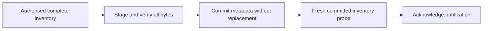

# Proposed native package storage

> Design for [#1239](https://github.com/AlexaDeWit/Ecluse/issues/1239), awaiting owner approval.
> Filesystem and S3 package backends are planned features in milestones 12 and 13.
> This proposal changes no shipped backend, configuration, or supported role.

## What makes a version visible?

A version becomes visible only when its completion marker commits after all required metadata and artifact bytes finish.
This settled requirement applies to every supported role and ecosystem, including direct publication.
Metadata reads, package listings, version listings, artifact GET and HEAD, and companion reads must consult the committed marker.
The presence of artifact files or objects never proves completion.
A guessed artifact path must pass the same check.

Recommend one bounded, versioned JSON metadata document as the marker.
Its storage representation contains the following fields, independent of Haskell runtime serialisation:

- The ecosystem, canonical package identity, version, and schema version.
- The complete filename inventory, verified algorithm-tagged digests, byte lengths, and immutable storage references.
- Supported source metadata paired with the admitted version, including declared companion bytes or immutable references.

The codec rejects duplicate filenames, mismatched identities, unsupported schemas, invalid references, and exceeded bounds.
It preserves the existing [supported field contract](../../web/content/docs/protocol-support.md), rather than defining another ecosystem field set.
Project envelopes and mutable npm tags remain separate from immutable version membership.
An update may point to a version only after that version commits.

A separate marker is an alternative when metadata cannot carry the commit barrier.
It names immutable metadata by digest, so readers validate both objects.
Metadata-last is the recommendation because it needs one committed document lookup.
These are alternative designs, not two required mechanisms.

Missing markers mean absence.
Invalid markers, missing committed bytes, or failed storage operations mean explicit unavailability, never partial success.
Aggregated metadata must not silently omit a committed version whose required data cannot be read.

## How does publication survive interruption?

Every publication begins with a complete candidate inventory and an authorised publication scope.
The mirror worker already admits whole-version inventory through `MirrorInventory` and verifies files through `ExpectedMirrorFile` and `VerifiedArtifactBytes`.
Retain the paired source data represented by `MirrorReadData`.
An individual upload does not establish the complete set, even when its bytes pass verification.

Each candidate owns immutable data keys, isolated from concurrent candidates.
Encode identity components injectively, so distinct valid identities never collide.
Never interpret raw package names, filenames, source URLs, or publisher-provided references as filesystem paths.
The marker codec accepts only backend-owned references within the selected store namespace.

The marker create is the point where one publisher wins the version identity.
An existing marker succeeds idempotently only when its immutable membership, digests, and required stored metadata match.
Compare semantic content, excluding temporary candidate keys and transient download URLs.
Conflicting immutable content returns a named conflict without overwriting the winner.
Mutable project metadata remains outside that comparison where the ecosystem contract permits changes.

| Interruption or race | Required outcome |
| --- | --- |
| Before all required bytes finish | Readers and listings see no version. Retry verifies or replaces incomplete candidate data. |
| After data completion, before marker creation | The version remains absent. Restart may reuse verified durable candidates. |
| Marker creation fails or its acknowledgement disappears | Reread the marker. Equivalent content resolves success, conflicting content refuses, and unresolved storage failure retries. |
| Concurrent equivalent publishers | One marker wins. The other publisher verifies equivalence and succeeds idempotently. |
| Concurrent conflicting publishers | One marker wins. The loser reports an immutable-version conflict. |
| Restart with staging data only | Staging never proves completion. Repeat verification before attempting commit. |

Orphan cleanup has separate authority and does not affect visibility.
The worker gains no deletion permission.
Initial delivery can retain unreachable candidates until independently authorised cleanup runs.
Age alone does not establish that a candidate has no active publisher.

## Which filesystem guarantees are required?

Bind operations to a trusted root directory handle and reject symbolic-link traversal beneath it.
Canonical-path checks alone do not protect later operations from path substitution.
Stage on the same filesystem, flush completed files, and flush directories containing newly created entries.
Then write and flush temporary metadata, create the final marker atomically without replacement, and flush its directory before acknowledging durable success.

Ordinary rename can overwrite the winner.
Linux offers [`renameat2(RENAME_NOREPLACE)`](https://man7.org/linux/man-pages/man2/rename.2.html) for no-replace publication.
The [`fsync` contract](https://man7.org/linux/man-pages/man2/fsync.2.html) also requires flushing the directory to persist its new entry.
A supported equivalent is acceptable.
Refuse this capability on platforms or filesystems without the required atomicity and durability.
An existence check followed by rename is not equivalent.

After an uncertain directory flush, marker presence alone does not establish durable success.
Retry must complete the durability operations or report storage unavailability.
A crash may lose an unacknowledged marker, but must never leave a durable marker pointing at unfinished data.

## Which S3 guarantees are required?

Upload immutable candidate objects and finish multipart uploads before creating the metadata marker with `If-None-Match: *`.
List-then-put cannot choose one winner.
On `412`, compare the committed marker.
On uncertain transport results, perform the same readback before deciding success.
Handle `409` through bounded retry and current-state inspection.
AWS requires restarting a conditional multipart upload after that conflict.
These outcomes follow the [conditional-write contract](https://docs.aws.amazon.com/AmazonS3/latest/userguide/conditional-writes.html).

Require conditional creation and strong GET and LIST consistency from the selected service.
[AWS documents those consistency guarantees](https://aws.amazon.com/s3/consistency/), but they do not establish another provider's behaviour.
Refuse only the incompatible capability or configuration, while preserving compliant providers and other supported roles.
Compute artifact digests independently rather than treating an ETag as an artifact checksum.

## Who may read and delete?

Process filesystem or S3 credentials grant storage access, not a caller's right to read a package.
The existing [credential contract](registry-model.md#credential-flow-and-authority) gives private read authority to the caller's upstream credential.
Native private reads need an approved equivalent before activation.

Construct native `MetadataClient` and artifact handles only after establishing the request's authorised mount, namespace, and package scope.
Bind that scope when the server constructs its private read capabilities, where `MetadataReads Private` currently enters `privateMetadataClient`.
Every metadata, listing, artifact, and companion operation must enforce the bound scope.
Keep these reads outside the shared anonymous cache.
Mirror publication instead uses its configured worker authority and admitted complete inventory.
Maintenance retains its independently scoped observation and deletion authority.

Use the existing `StoreMaintenance` consent checks and Dredger reassessment before each destructive batch.
Bind filesystem consent to a persistent store identifier within the opened root and its namespace.
Bind S3 consent to the configured service authority, bucket, namespace, and persistent store identifier.
The operator creates consent. Neither the worker nor Dredger creates or broadens it.
Keep consent separate from completion markers and sweep cursors.

Refuse the configured OSV bucket as a package store even when the object prefix differs.
Check configured store identity at boot or capability construction, without inventing remote alias discovery.

Deletion withdraws the observed marker before reclaiming that candidate's bytes.
It must not remove a replacement marker or bytes belonging to a concurrent publication.
The backend must serialise version deletion with publication, or condition deletion on the observed marker identity.
Preserve per-version outcomes and re-observation after uncertain deletion through `StoreMaintenance`.
Readers during deletion either obtain a complete usable view or report explicit unavailability.
The backend declares refill behaviour through `StoreFacts`, consistent with the existing immutable-publication contract.

## How does this fit the current capabilities?

Keep ecosystem encoding separate from concrete storage operations, as required by the [registry abstraction](registry-model.md#registry-abstraction).
`OriginClient` remains an HTTP adapter input rather than becoming a universal storage record.
The existing S3 mirror-state store records expected source evidence. It is not a package store or a package completion marker.

| Current boundary | Proposed extension and retained guarantee |
| --- | --- |
| [`MetadataClient`](../../core/src/Ecluse/Core/Registry/Metadata.hs) | Supply committed full and selected reads, with existing bounds and paired metadata. Add native typed faults where HTTP outcomes cannot represent failures. |
| [`MirrorPublish`](../../core/src/Ecluse/Core/Registry/Publish/Internal.hs) | Retain checked preparation. Add explicit whole-version finalisation after verified data and companion completion. HTTP publication keeps its current completion rules. |
| [Worker completion](../../core/src/Ecluse/Core/Worker/Job.hs) | Revalidate the latest required inventory before native finalisation, then run the fresh target probe. Never acknowledge a stale or incomplete set. |
| [Artifact capability](../../core/src/Ecluse/Core/Registry/Adapter/Capability.hs) | Add native bounded reads because current builders return HTTP requests. Enforce marker membership for GET, HEAD, and companions. |
| [`StoreMaintenance`](../../core/src/Ecluse/Core/Registry/Maintenance.hs) | Derive enumeration and manifest membership from markers. Preserve consent, guarded batches, deletion outcomes, refill facts, and optional cursors. |

Composition would select native handles only for approved roles and ecosystems.
Concrete filesystem and S3 adapters belong at the runtime edge.
The delivery PRs must update configuration, operator guidance, and the threat model when those interfaces become available.
No extra HTTP service is required by this proposal.

## What proves backend acceptance?

Each backend needs its own [full package-store contract](cloud-backends.md#onboarding-a-backend) and independently declared ecosystem obligations.
Passing a mirror-only subset must not claim full package-store completion.
Reuse existing metadata, mirror, and maintenance laws through production handles.
Add the following observations to deterministic specs and filesystem or emulated-service integration tests:

- Interrupt every publication phase, restart, and check all listing and direct-read forms from the visibility contract.
- Race equivalent and conflicting publishers, including lost commit acknowledgements and uncertain directory flushes.
- Reject forged references, symbolic links, identity collisions, duplicate filenames, invalid schemas, and exceeded metadata bounds.
- Refuse partial committed data, preserve caller isolation, and reject reads outside the authorised scope.
- Exercise consent withdrawal, root replacement, uncertain deletion, concurrent refill, and OSV bucket refusal despite a different prefix.
- Measure aggregation, staging memory, and storage operation counts under the existing admission and residency budgets.

Backend delivery must supply this runtime evidence. Documentation review does not prove these guarantees.

## What remains for owner approval?

Recommend metadata-last commits and an initial publication scope based on admitted whole-version mirror inventory, with maintenance support.
This recommends a delivery order, not an approved exclusion of other valid backend roles.
The owner must approve the representation and role scope before backend work starts.

Native private reads require a caller-authorisation contract before activation, including the rule that produces the bound request scope.
Existing mirror configuration also requires a private upstream, so usable delivery must preserve that topology requirement.
Approval must identify its authorised readback path rather than silently enabling process-wide private access.

Direct first-party PyPI uploads carry one distribution and no complete-version inventory or completion signal.
Before activating that role, define how the publisher supplies that evidence.
Neither the first upload nor an inactivity timeout proves completion.
This open protocol choice does not weaken the universal visibility requirement or prevent otherwise valid mirror and maintenance capabilities.
